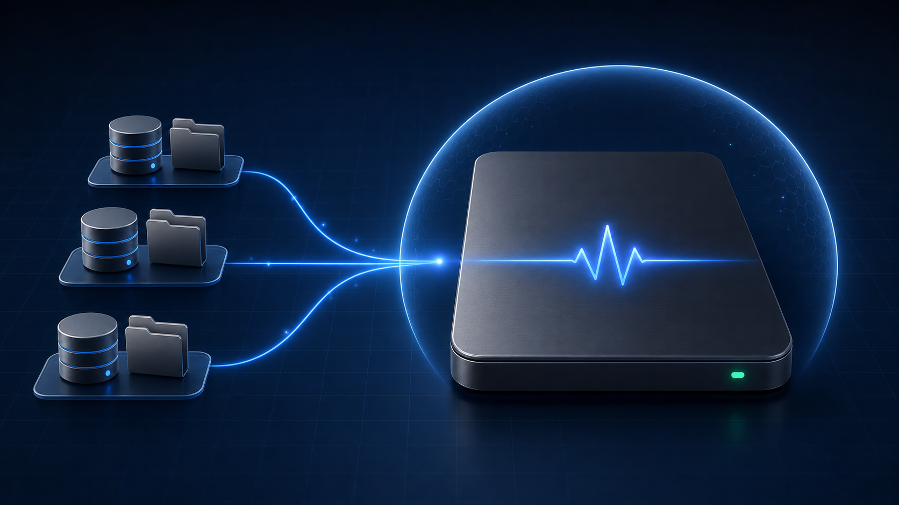

# SSD Watcher

[](https://github.com/Takhoffman/ssd-watcher/actions/workflows/ci.yml)
[](LICENSE)
[](https://support.apple.com/macos)



SSD Watcher is a native macOS menu-bar utility that detects abnormal disk-write
activity before it quietly consumes storage endurance.

It recognizes Codex, OpenClaw, and Hermes data stores by their SQLite structure.
Default homes, named profiles, custom homes, renamed folders, external volumes,
and databases held open by live processes are all supported. Discovery never
depends on one hard-coded folder name.

## What it does

- Discovers Codex, OpenClaw, and Hermes locations automatically, including
  several homes or profiles on one Mac.
- Verifies SQLite schemas before monitoring a candidate.
- Samples append-only record counters and on-disk growth without reading
  message or log content.
- Samples watched locations every 10 seconds by default and rediscovers new
  locations every five minutes.
- Shows live rates, storage totals, health, and short activity history.
- Sends a native notification when activity becomes abnormally high.
- Supports launch at login and secure in-app updates.

Normal agent activity is usually far below SSD Watcher's default thresholds.
The defaults are intentionally conservative: 100 new records/second is
elevated and 1,000 records/second is critical. A 1 MB/second database-growth
rate is also elevated, even when a reliable record counter is unavailable.

## Install

Use either familiar Mac installation path:

1. Download the signed and notarized DMG from
   [GitHub Releases](https://github.com/Takhoffman/ssd-watcher/releases), drag
   SSD Watcher to Applications, and open it.
2. Install the Homebrew Cask:

   ```sh
   brew install --cask Takhoffman/tap/ssd-watcher
   ```

DMG installations update securely inside the app. Homebrew users can also run
`brew upgrade --cask ssd-watcher`.

## Product principles

- Useful immediately, without developer knowledge.
- Native, quiet, and visually clear.
- No accounts, advertising, or analytics.
- Never reads authentication data or log message contents.
- Never deletes files or terminates applications automatically.
- Open source under the MIT license.

## Development

Requirements:

- macOS 14 or newer
- Xcode 16 or newer
- [XcodeGen](https://github.com/yonaskolb/XcodeGen)

Generate the project and build:

```sh
make generate
make build
```

Build products use `/tmp/SSDWatcherDerivedData` because Xcode’s build database
cannot be hosted reliably on every external APFS volume.

Run tests:

```sh
make test
```

Run the same repository checks used by CI:

```sh
make check
```

The generated `SSDWatcher.xcodeproj` is intentionally committed so the project
opens normally in Xcode. `project.yml` remains the source of truth.

## Detection and privacy

SSD Watcher uses a layered discovery strategy:

- known default locations and likely profile containers;
- Codex, OpenClaw, and Hermes configuration and data markers;
- open database files held by live agent processes;
- Spotlight filename matches in the home folder and mounted local drives;
- a strict SQLite schema fingerprint; and
- folders added manually by the user.

Recognized layouts include:

| Tool | Canonical stores |
| --- | --- |
| Codex | `logs_<n>.sqlite` in each Codex home |
| OpenClaw | `state/openclaw.sqlite` plus `agents/<id>/agent/openclaw-agent.sqlite` |
| Hermes | Per-profile `state.db`, optional `memory_store.db`, `projects.db`, `verification_evidence.db`, cron execution stores, and Kanban board databases |

It reads only paths, database schemas, record counters, file sizes, and
timestamps. It never reads prompt or response text, authentication files, or
credentials. It does not send analytics or anonymous system profiles. It never
deletes a database or terminates an agent process automatically.

See the complete [privacy explanation](docs/PRIVACY.md) and
[technical architecture](docs/ARCHITECTURE.md).

## Distribution

Public releases use the same signed and notarized app bundle for:

- A DMG from GitHub Releases, with secure in-app updates powered by Sparkle.
- A Homebrew Cask for `brew install --cask ssd-watcher`.

Release signing and notarization are documented in `docs/RELEASING.md`.

## Community

Bug reports, detector requests, and feature ideas are welcome. Please read
[CONTRIBUTING.md](CONTRIBUTING.md) before opening a pull request and use
[SECURITY.md](SECURITY.md) for sensitive reports.

SSD Watcher is an independent project. It is not affiliated with or endorsed
by OpenAI, OpenClaw, or Nous Research.
